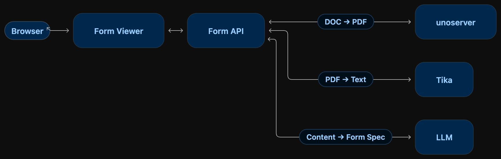

# Cyfryzacja formularzy

## Budowanie obrazu Docker

```bash
docker compose build
```

## Uruchomienie aplikacji

Utwórz plik `.env.local` (ignorowany przez Git) z ustawieniami modelu i sekretami.
Jego wartości zastępują domyślne z `.env`.

```dotenv
LLM_ENGINE_URL=https://openrouter.ai/api/v1
LLM_MODEL=nvidia/nemotron-3.5-super-vl
LLM_API_KEY=<klucz API OpenRouter>
JWT_SECRET=<co najmniej 32 znaki>
JWT_CLIENT_SECRET=<co najmniej 32 znaki, inny niż JWT_SECRET>
```

```bash
docker compose up
```

## Architektura



- **Form Viewer** (`form-viewer`, Flask): przyjmuje plik od
  użytkownika, przekazuje go do `form-api` (z tokenem JWT, jeśli uwierzytelnianie
  jest włączone) i renderuje otrzymany JSON jako podgląd formularza
  wraz z wynikiem walidacji. Pozwala też podejrzeć i pobrać sam JSON.
- **Form API** (`form-api`, FastAPI): waliduje plik, sprowadza go do
  PDF, wyciąga tekst i obrazy stron, wysyła je do modelu, a z jego odpowiedzi
  buduje i waliduje konfigurację formularza w zadanym formacie
- **unoserver** (LibreOffice): konwertuje dokumenty DOC, DOCX, ODS i XLSX do PDF
  (obrazy JPG i PNG `form-api` zamienia na PDF samodzielnie)
- **Tika** (Apache Tika z OCR Tesseract): wyciąga tekst z PDF
  strona po stronie (także ze skanów)
- **LLM** (dowolny backend zgodny z API OpenAI, obsługujący `json_schema`):
  na podstawie obrazów stron i wyciągniętego tekstu zwraca strukturę formularza.
- Dłuższe formularze są dzielone na fragmenty

## Konfiguracja

Zmienne środowiskowe (wartości domyślne w `.env.example`):

- `MAX_UPLOAD_SIZE_BYTES`: maksymalny rozmiar pliku (domyślnie 10 MiB),
- `MAX_FORM_PAGES`: maksymalna liczba stron formularza źródłowego (domyślnie 20;
  `-1` wyłącza limit)
- `LLM_ENGINE_URL`, `LLM_MODEL`, `LLM_API_KEY`: backend LLM zgodny z API OpenAI
  i obsługujący format odpowiedzi `json_schema` (Docker Model Runner, llama.cpp, vLLM)
- `LLM_TIMEOUT_SECONDS`, `LLM_MAX_OUTPUT_TOKENS` (domyślnie 16000)
  `LLM_CHUNK_CHARS` (domyślnie 6000), `LLM_MAX_IMAGES_PER_REQUEST` (domyślnie 4):
  limity żądań do modelu; dłuższe formularze są dzielone na fragmenty według stron
- `LLM_DISABLE_REASONING`: wyłącza tryb rozumowania modelu (domyślnie `true`);
  modele rozumujące zużywają inaczej limit `LLM_MAX_OUTPUT_TOKENS` na samo rozumowanie
- `EXTRACTOR_URL`, `CONVERTER_URL`: adresy usług Tika i unoserver
- `JWT_SECRET`, `JWT_CLIENT_SECRET`, `JWT_ISSUER`, `JWT_AUDIENCE`: uwierzytelnianie JWT
- `LOG_LEVEL`: opcjonalne nadpisanie poziomu logowania

Aplikacja `form-viewer` ma osobny plik `form-viewer/.env` (ignorowany przez Git).
Utwórz go z `form-viewer/.env.example` i ustaw `FLASK_SECRET_KEY`:

```bash
sed "s/^FLASK_SECRET_KEY=.*/FLASK_SECRET_KEY=$(python3 -c 'import secrets; print(secrets.token_hex(32))')/" form-viewer/.env.example > form-viewer/.env
```

Ustawienie `JWT_SECRET` wymaga tokenu Bearer (HS256) na `POST /form`; pusty sekret
wyłącza uwierzytelnianie. `JWT_CLIENT_SECRET` włącza `POST /token`. Oba sekrety można
wygenerować i dopisać do `.env.local` poleceniem:

```bash
python3 -c 'import secrets; print("JWT_SECRET=" + secrets.token_hex(32)); print("JWT_CLIENT_SECRET=" + secrets.token_hex(32))' >> .env.local
```

Gdy uwierzytelnianie jest włączone, wpisz tę samą wartość `JWT_CLIENT_SECRET` do
`form-viewer/.env`. `form-viewer` pobiera wtedy token z `POST /token` przed każdym
wysłaniem formularza.

## REST API

`POST /form` (multipart, pole `file`) przyjmuje jeden plik formularza w formacie:

- PDF
- DOC
- DOCX
- ODS
- XLSX
- JPG
- JPEG
- PNG

Odpowiedź: JSON z konfiguracją formularza; nagłówek `X-Form-Warnings`
zawiera ostrzeżenia generatora.

Walidacja (błędy 400/413/415):

- rozszerzenie musi być jednym z: pdf, doc, docx, ods, xlsx, jpg, jpeg, png
- typ MIME wykryty z zawartości musi odpowiadać rozszerzeniu
- nazwa pliku ma najwyżej 250 znaków i nie zawiera `; : > < / \ | ' * % $`
- rozmiar pliku nie przekracza `MAX_UPLOAD_SIZE_BYTES`

`POST /token`: klient przesyła `JWT_CLIENT_SECRET` w nagłówku Bearer i otrzymuje JWT
ważny 15 minut.

```bash
JWT_CLIENT_SECRET="$(sed -n 's/^JWT_CLIENT_SECRET=//p' .env.local | tail -n 1)"

token="$(
  curl -sS -X POST \
    -H "Authorization: Bearer $JWT_CLIENT_SECRET" \
    http://localhost:8080/token |
  python3 -c 'import json, sys; print(json.load(sys.stdin)["access_token"])'
)"

curl -X POST \
  -H "Authorization: Bearer $token" \
  -F 'file=@/path/to/form.pdf' \
  http://localhost:8080/form
```
